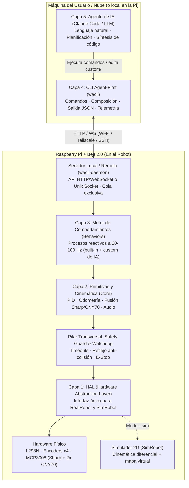
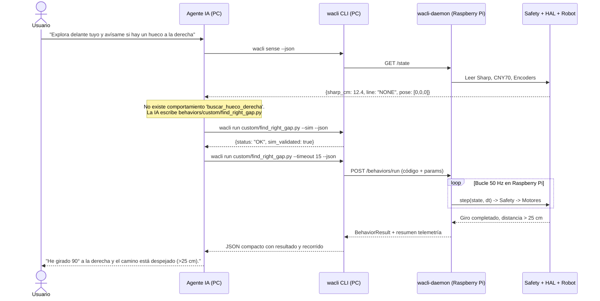

# 2. Arquitectura Propuesta para WaCLI

## 2.1 De la pirámide de 4 niveles a una arquitectura de 5 capas + transversales

La pirámide original se refina en **5 capas verticales** más **2 pilares transversales** (Seguridad y Abstracción/Simulación) y una **frontera de red** que permite el control remoto.

---

## 2.2 Descripción detallada de cada capa

### Capa 1 — HAL (Hardware Abstraction Layer) y Drivers
Encapsula el acceso directo al hardware físico descrito en [conexiones_robot.md](./conexiones_robot.md) detrás de interfaces limpias:

- **`MotorDriver`**: controla el L298N por `IN1..IN4` y `ENA/ENB` (PWM a 1 kHz). Aplica internamente `INVERTIR_DER = True`, compensa la **zona muerta** (~28–30 % PWM para arrancar) y soporta frenado activo (`IN1=IN2=1`) vs. rueda libre (`IN1=IN2=0`).
- **`EncoderReader`**: escucha interrupciones en `B26/B21` y `B16/B20` con decodificación **x4** en segundo plano, aplicando `INVERTIR_ENC_IZQ` / `INVERTIR_ENC_DER`.
- **`AnalogBus` (MCP3008)**: lee `/dev/spidev0.0` (1 MHz, 3.3 V) con lock de hilo para evitar lecturas corruptas:
  - `CH0` → **Sharp GP2Y0A41SK0F** (filtro de mediana de 5–7 muestras + interpolación lineal sobre la tabla de calibración).
  - `CH1` / `CH2` → **CNY70 izq./der.** (valor bruto ADC + booleano `on_line` usando umbrales individuales `728.1` y `581.2`).
- **`BuzzerDriver`** (futuro): cuando se resuelva el pin seguro del zumbador, expone `beep(freq, duration)` y melodías simples.
- **`SimRobot` (implementación alternativa)**: implementa exactamente la misma interfaz `RobotHAL` pero simulando la cinemática diferencial en memoria, permitiendo ejecutar los mismos comportamientos y tests sin encender los motores reales.

### Pilar Transversal — Safety Guard & Watchdog
Se sitúa **entre las primitivas y el hardware** y **no puede ser modificado por la IA**:

- **Watchdog de movimiento**: si nadie refresca un comando de velocidad en `N` ms (ej. 500 ms en modo teleoperación) o un comportamiento supera su `--timeout` máximo, corta los motores automáticamente.
- **Reflejo anti-colisión**: si el robot está ordenando avance positivo y el Sharp lee `< 6 cm` (margen sobre el límite no fiable de 4 cm), detiene el avance y devuelve código de salida `OBSTACLE_STOP` (se puede relajar solo con una bandera explícita para tareas como empujar un objeto).
- **Parada de emergencia (`E-Stop`)**: un endpoint/comando de máxima prioridad (`wacli stop`) que cancela cualquier comportamiento en curso y frena inmediatamente los motores.
- **Límites eléctricos y térmicos**: rampa de aceleración suave (*slew-rate limiter*) para evitar picos de corriente en las 4 pilas AA que puedan reiniciar o desestabilizar la lógica.

### Capa 2 — Primitivas y Cinemática (`core/`)
Traduce lecturas crudas y PWM en conceptos robóticos de ingeniería:

- **Odometría diferencial continua**: integra los ticks de ambos encoders (`R = 32.5 mm`, `L` distancia entre ruedas, `CPR`) para mantener la pose estimada `(x, y, theta)` y velocidades `(v, omega)`.
- **Controladores cerrados (PID)**:
  - `move_distance(cm, speed)`: avanza recto corrigiendo desviación entre rueda izquierda y derecha con los encoders.
  - `turn_angle(deg, speed)`: gira sobre su eje un ángulo preciso usando encoders.
  - `set_velocity(v, omega)`: cinemática inversa de tracción diferencial.
- **Percepción procesada**: estado unificado `RobotState` (pose, velocidades, distancia Sharp filtrada, estado de línea `LEFT | RIGHT | BOTH | NONE`, timestamp, estado de seguridad).

### Capa 3 — Motor de Comportamientos (`behaviors/`)
Es el nivel de **procesos** de tu pirámide original, estandarizado con un contrato claro:

- Cada comportamiento es una clase o función Python que hereda de `Behavior` con un ciclo de vida limpio: `setup()`, `step(state, dt)` (ejecutado a frecuencia fija, ej. 50 Hz) y `teardown()` (siempre garantiza parar motores al salir).
- **Dos categorías con permisos distintos**:
  - `behaviors/builtin/`: comportamientos probados y estables mantenidos por humanos (`follow_line`, `avoid_obstacles`, `explore_room`, `scan_360`, `square_patrol`, `calibrate_motors`).
  - `behaviors/custom/`: **zona de trabajo de la IA**. El agente puede crear, modificar y probar aquí nuevos comportamientos en tiempo real sin tocar el núcleo.
- **Condiciones de parada composables**: todo comportamiento devuelve un `BehaviorResult` estructurado (`status`, `reason`, `duration_s`, `distance_cm`, `telemetry_summary`).

### Capa 4 — Daemon + CLI Agent-First (`daemon/` y `cli/`)
Separa el **dueño del hardware** de la **interfaz de usuario/agente**:

- **`wacli-daemon` (en la Raspberry Pi)**:
  - Proceso persistente (servicio `systemd`).
  - Único dueño de GPIO y SPI; garantiza exclusión mutua (solo un comportamiento activo a la vez).
  - Mantiene la odometría viva entre comandos.
  - Expone una API ligera (HTTP + WebSocket para streaming de telemetría/cancelación) accesible por red local (Wi-Fi / Tailscale) o socket local.
- **`wacli` (Cliente CLI)**:
  - Puede ejecutarse en tu portátil (donde corre Claude Code) apuntando a `WACLI_HOST=http://robot.local:8000` o directamente dentro de la Raspberry Pi.
  - Soporta **comandos atómicos** (`move`, `turn`, `sense`, `stop`), **comportamientos** (`run follow_line`), **secuencias/pipelines** (`sequence` o encadenado en shell) y **sincronización de comportamientos custom** (subir un script creado por la IA al daemon remoto y ejecutarlo).

### Capa 5 — Agente de IA (Cima)
No es un módulo monolítico dentro de WaCLI, sino el **usuario inteligente del CLI y del repositorio**:

- Lee un archivo de contexto del repositorio (`AGENTS.md` / `CLAUDE.md`) que le explica las capacidades físicas del robot, los comandos `wacli`, los límites del Sharp/CNY70 y las reglas de seguridad.
- Traduce intenciones en lenguaje natural (*"busca la línea negra, síguela y si encuentras algo delante rodéalo"*) en:
  1. Llamadas directas a comportamientos existentes, o
  2. Composición de varios comandos según el resultado de cada paso, o
  3. Creación de un nuevo script en `behaviors/custom/`, verificación en `--sim`, despliegue y ajuste iterativo según telemetría real.

---

## 2.3 Flujo de ejecución típico (Control Remoto + Creación en Tiempo Real)

